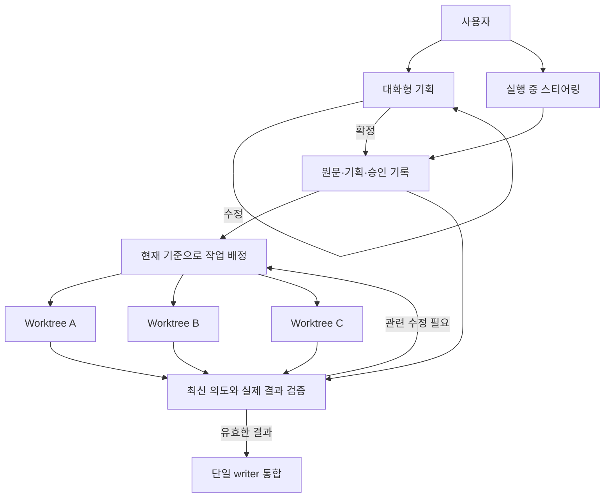

# 설계 — 사용자의 의도가 실행을 계속 지휘하게 하기

## 1. 무엇을 최적화하는가

최우선은 현재 사용자가 원하는 결과와 실제 산출물이 일치하는 것이다. 그다음은 사용자가 기획과 진행 방향을 쉽게 바꾸는 능력, 그리고 검증된 완료까지 걸리는 시간이다. 총토큰이나 세션 수는 이 목표를 설명하는 관측값이며, 그 자체를 최소화하지 않는다.

순서는 다음과 같다.

1. 현재 유효한 목표·제약·사용자 통제의 준수.
2. 원문과 실제 결과를 대조할 수 있는 검증 가능성.
3. 유용한 병렬화로 완료 시간 단축.
4. 결정을 바꾸지 못하는 반복 추론과 중복 작업 제거.

과추론은 “생각을 오래 했다”와 동의어가 아니다. 해결되지 않은 큰 불확실성을 실제 실험으로 줄이는 긴 작업은 필요할 수 있다. 반대로 두 문단짜리 형식적인 자기검토도 아무 근거를 추가하지 않으면 낭비일 수 있다.

## 2. Felix의 철학을 어떻게 적용하는가

Felix는 속도 외에 상위 성과, 전문가의 원자료·방법, 다른 분야의 방법을 가져오는 관점을 제시한다. 이 문서는 그것을 다음처럼 적용한 설계 제안이다. 원문이 특정 OMP 구조를 추천했다는 뜻은 아니다. [S1]

| 관점 | 이번 적용 |
|---|---|
| 상위 성과 | agent 수를 관리하는 사용자가 아니라 원하는 결과와 방향을 결정하는 사용자 |
| 깊이 | 기획 원문·코드 변경·실행 로그·테스트 결과로 의미와 결과를 확인 |
| 범위 | 버전 관리의 revision, 제어 시스템의 확인 응답, 빌드 시스템의 의존성, 트랜잭션의 조건부 채택을 결합 |
| 외부 판단 | 모델의 자기평가 대신 재현 가능한 도구 검사, 사용자 승인, 원문 기준 평가 |

야심을 키우는 것은 미승인 기능을 늘리는 일이 아니다. 같은 목표에 필요한 원자료를 더 직접 보고, 더 좋은 방법을 쓰고, 결과의 정확성을 더 강하게 확인하는 일이다. 큰 대안은 기획 중 비교 가능한 제안으로 올린다.

## 3. 사용자가 보는 네 단계

### 함께 기획하기

초기 자연어에서 현재 이해한 목표와 중요한 선택을 보여 준다. 사용자가 바꾼 부분을 바로 반영하고, 무엇이 달라졌는지 짧게 표시한다. 필요한 read-only 조사와 비교 실험을 수행하되 기획이 끝났다는 모델의 판단만으로 제품 구현을 시작하지 않는다.

### 확정한 기획 구현하기

사용자가 특정 기획을 확정하면 해당 snapshot과 승인 근거를 묶는다. 구현 방법은 필요에 따라 개선할 수 있지만, 목표·범위·명시 제약·중요한 제품 선택의 변경은 사용자 근거와 연결한다.

### 언제든 방향 바꾸기

사용자 입력을 긴 모델 응답 뒤로 미루지 않는다. 실행 host가 먼저 받아 기록하고, 중단·수정·상태 질문·새 목표를 구분한다. 영향받는 작업을 멈추거나 새 지시로 이어가며 무관한 작업은 유지한다. 화면은 접수와 반영 완료를 다른 상태로 표시한다.

### 실제 결과 확인하기

작업자들의 완료 선언을 모아서 끝내지 않는다. 통합된 결과가 현재 기획과 원문 기준을 충족하는지 검증한다. 명세가 처음부터 잘못 번역됐을 가능성을 남겨 두고 검사한다.

## 4. 구조: 대화와 실행을 연결하는 작은 제어 계층

권장 구조는 한 사용자 창구, 한 canonical writer, 여러 작업 세션이다. 제어 계층은 모델이 아니며 별도 서버를 요구하지도 않는다. 한 extension 프로세스의 모듈과 영속 journal로 시작할 수 있다.

| 구성 | 책임 |
|---|---|
| 대화형 기획 UI | 현재 기획·수정 내용·확정 대상을 사용자에게 보여 줌 |
| 입력·의도 제어 | 원문 기록, revision, 승인, steering 대상, pause/cancel 상태 |
| 작업 배정 | 의존성·소유 범위·가용 실행 역량을 보고 준비된 작업 실행 |
| 실행 어댑터 | 지정 cwd/model/context의 OMP 세션, 메시지 전달, 취소, 상태 수집 |
| Git 통합 | 작업 산출물 보존, 후보 통합, 정확한 commit 검증, 조건부 채택 |
| context 구성 | canonical 기록에서 작업별 최신 입력 생성 |

코드 모듈은 나눠도 독립 플러그인 여러 개가 각자 승인·목표·작업 상태를 소유하게 하지 않는다. 이것은 작은 로컬 workflow이며 Temporal·분산 큐·벡터 DB·상시 여러 manager는 초기 필수 조건이 아니다.

스티어링이 들어오면 기록을 갱신하고 영향받는 작업의 실행 조건을 바꾼다. 그림의 worktree 수는 예시이며 실제 동시성 상한을 뜻하지 않는다.

## 5. 보존하는 업무 상태

v2의 세 record를 확장한다. 입력과 승인·전달은 이 record에 대한 사건이며, 각각 새 agent를 만들 이유가 아니다.

| Record | 주요 내용 |
|---|---|
| Intent | 원문 참조, 기획 revision/digest, 현재 목표·제약·허가, 승인 근거, 변경 이력 |
| WorkItem | 관련 요구·입력/출력 계약, 선행 작업, read/write 범위, 현재 영향 버전, worktree·세션·시도 ID |
| Result | 생성 시 기준, 정확한 commit/patch, 검사와 근거, 미충족·미실행, 채택 또는 보류 사유 |

원문은 불변이고 정규화된 해석은 교정할 수 있다. 관찰·가정·제안·사용자 지시는 구분한다. 허가는 반드시 수행할 목표와 다르다. 실행하지 않은 필수 검사는 `not_run`, 쓰지 않아도 되는 허가는 `not_applicable`로 구별한다.

기록 방식은 설치 환경에 맞춰 선택한다. Native session custom entries가 충분하면 재사용한다. 여러 프로세스와 복구에 별도 run journal이 필요하면 그것을 canonical로 삼고 native session은 참조만 가진다. 두 저장소를 동등한 진실로 운영하지 않는다.

## 6. 의도 보존은 네 곳에서 일어난다

1. **이해:** 원문의 의미와 compiler의 해석을 비교한다.
2. **전달:** 작업자가 현재 기준을 받았는지 확인한다.
3. **행동:** 다음 제어 가능한 변경 전에 유효한 작업 허가와 기준을 확인한다.
4. **채택:** 실제 결과가 현재 기준을 만족하는지 확인한 뒤 통합한다.

긴 system prompt에 “원래 의도를 잊지 마라”를 반복하는 것만으로는 이 네 조건을 충족하지 못한다. 반대로 revision 필드가 맞다고 결과가 의미적으로 옳은 것도 아니다. 기계적인 전달 검사와 의미·결과 검증을 모두 둔다.

모든 수정에 전체 run을 재시작하지 않는다. 전체 기획 revision은 이력을 설명하고, 작업별 영향 버전은 해당 작업의 유효성을 판단한다. 무관한 수정이라는 판단에도 요구·의존성·산출물 범위 근거가 필요하다.

## 7. 병렬성을 키우는 기준

준비된 독립 작업은 가용 역량까지 적극 실행한다. 다음을 병렬화할 수 있다.

- 서로 다른 모듈 구현과 각 모듈의 테스트.
- 큰 자료·로그·코드 조사에서 서로 다른 질문의 해결.
- 중요한 불확실성에 대한 서로 다른 가설의 재현 실험.
- 안정된 후보에 대한 서로 다른 실패 유형의 검토.

같은 목표와 같은 자료로 표현만 다른 분석을 무한히 늘리는 것은 병렬성의 성과가 아니다. 무엇을 다르게 알아낼지와 어떤 결정을 내릴지를 지정한다. 하나의 가설이 충분히 검증되면 더 이상 필요한 결정을 바꾸지 않는 후보를 종료한다.

컨텍스트 분리와 실제 파일 격리는 다르다. 모델 세션이 달라도 같은 디렉터리에 쓰면 충돌한다. Git worktree가 달라도 DB·포트·서비스·공통 refs는 충돌할 수 있다. 실행 어댑터가 이 경계를 관리한다. [S7]

## 8. 보장 가능한 것과 확인해야 하는 것

| 목표 | 구현하는 보장 | 남는 한계 |
|---|---|---|
| 입력 보존 | durable 기록 후 접수 표시, 재시도 중복 제거 | host 자체가 입력을 못 받는 장애는 별도 상태 |
| 적시 steering | 완료를 기다리지 않는 제어 경로, 다음 경계 검사 | 진행 중인 비중단 도구는 이미 효과가 났을 수 있음 |
| 최신 결과 | 관련 버전·입력·commit·검증을 비교한 뒤 채택 | 의미적 영향 분석의 누락은 검토로 탐지 |
| 자유로운 개입 | 자연어 질문·수정·pause·resume·cancel | 지원하지 않는 native 우회 입력은 정직하게 표시 |
| 빠른 병렬 구현 | 의존성 밖의 준비된 작업을 worktree에 배정 | 직렬 의존성·통합·공유 자원으로 한계 발생 |

현재 도구를 중단할 수 없는 경우에도 해당 결과를 채택하지 않는 제어는 가능하다. 중단 요청을 받았는데 “모두 중단됨”으로 표시하고 백그라운드가 계속 도는 일을 허용하지 않는다.

## 9. OMP와 pi 선택 원칙

OMP 기능을 쓰는 양보다 사용자의 정확한 동작을 구현하고 유지하는 총부담을 본다. 기본은 OMP이며, 핵심 의미를 OMP 내부 구조에 묶지 않는다. OMP의 공개 API가 특정 요구를 충족하지 못하면 해당 경계만 SDK/RPC로 보강한다. 여러 private API 패치로 사실상 새 실행기를 만들게 되면 pi를 다시 비교한다.

AgentFabric에 옮길 때는 그 Operation이 목표·승인·작업 상태의 유일한 소유자가 된다. 로컬 OMP controller와 AgentFabric controller가 동시에 같은 작업을 배정하지 않게 한다. 첨부 설계의 정적 Core와 Operation 상태 소유 경계는 참고하되, 현재 저장소의 실제 구현·버전은 다시 확인한다. [AF1, AF2]
